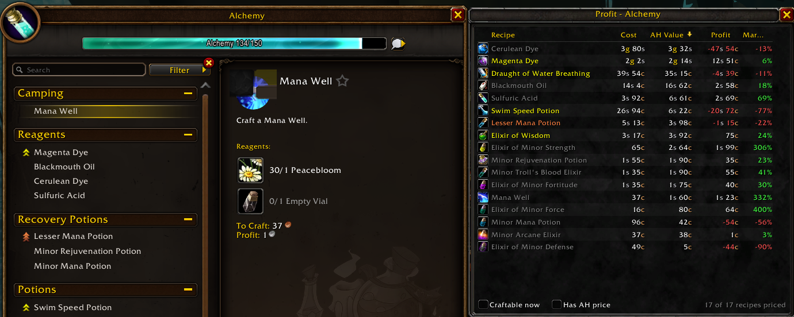

# Tylesser - Auctionator Profit Sort

A World of Warcraft addon that lists your profession recipes sorted by **profit**, **crafting cost**, **AH value** or **margin**, using the price data collected by [Auctionator](https://www.curseforge.com/wow/addons/auctionator).



## Features

- A panel docked next to the profession window, with one row per recipe:
  - **Cost**: reagent cost. A known vendor price is used first, otherwise the Auctionator price. An orange `*` means a reagent has no price.
    When another recipe of the same profession makes a reagent for less, its crafting cost is used instead ("crafted" in the tooltip).
  - **AH Value**: auction price × average amount made × 0.95 (the auction house cut).
  - **Profit** and **Margin** (profit as a percentage of cost).
- Click a column header to sort; click again to reverse the order.
- **Per Skill**: estimated cost per skill point (orange 100%, yellow ~75%, green ~25% chance). Sort by it to level a profession cheaply.
- **Owned free** option: count reagents already in your bags and bank as free. While it's on, the box shows how many recipes in the list it lowers the cost of, like "Owned free (12)".
- **Craft queue + shopping list**: right-click recipes to queue crafts, then **Shopping list** creates an Auctionator shopping list of the reagents you still need.
- **Profit in item tooltips**: items you can craft show their profit, like "Profit Sort: +2g 10s profit (cost 1g 80s)". The value follows the current auction price; the reagent cost is from your last time in that profession window.
- Make or buy and the tooltip line only know the recipes the profession window lists: a search or filter in that window leaves the hidden recipes out.
- **Vendor flip finder**: at any vendor, items worth at least 10% and 1 silver more on the auction house (after the 5% cut) get a green border, a "+profit" label and a tooltip line.
- Filters: **Craftable now** and **Has AH price**.
- **Min profit**: hide every recipe that loses money or earns less than the amount you type per craft (like `1s`, `50s` or `1g 50s`; a plain number is silver). Sort by Profit and the list ends where the profit stops.
- Click a row to select the recipe in the profession window; Shift-click to link the item in chat.
- Tooltip with the reagent cost breakdown and the age of the auction price.
- Refreshes automatically after Auctionator scans and when your bags change.

## Requirements

- [Auctionator](https://www.curseforge.com/wow/addons/auctionator). Scan the auction house at least once so prices are available.

## Usage

Open any profession. The panel appears on the right of the profession window.

| Command | Action |
| --- | --- |
| `/psort` or `/profitsort` | Show or hide the panel |
| `/psort reset` | Dock the panel next to the profession window again after you moved it |
| `/psort flips` | Turn the vendor flip marks off or on |
| `/psort options` | Open the options page (also in Esc > Options > AddOns) |
| `/psort feedback` | Get the link to report a bug or suggest an idea |

When the panel is closed, click the addon icon next to the profession window to open it again.

The options page (Esc > Options > AddOns, `/psort options`, or Profit Sort in the addon compartment by the minimap) turns the vendor flip marks, crafting cheaper reagents and the item tooltip line on or off.

## Feedback

Found a bug or have an idea? Click **Feedback** on the options page or type `/psort feedback` in game to get the link, or go straight to [tylesser.com/feedback](https://tylesser.com/feedback/#profitsort).

No GitHub account? Join the [Tylesser Discord](https://discord.gg/n2rEB6mRxF) and post in #bug-reports or #ideas with the addon's tag; each post is copied to GitHub and the bot answers with the link.

## Installation

Install from CurseForge, or download the latest zip from [Releases](https://github.com/Tylesser/ProfitSort/releases) and extract it to `Interface/AddOns`. The folder must be named `ProfitSort`.

## Releasing (maintainers)

Releases are built by [BigWigsMods/packager](https://github.com/BigWigsMods/packager). Push a version tag to publish to GitHub Releases and CurseForge:

```
git tag v1.0.0
git push origin v1.0.0
```

## License

[MIT](LICENSE)
