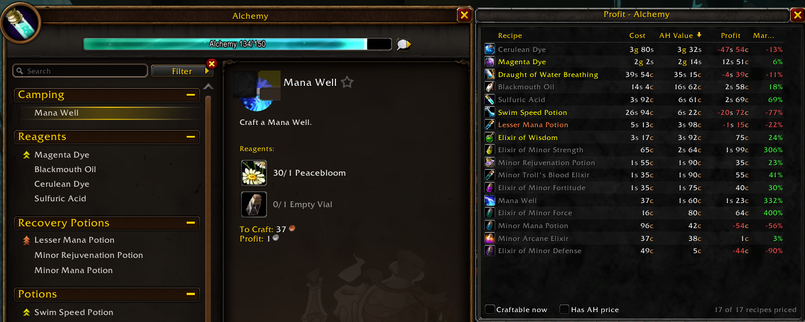

# Tylesser - Auctionator Profit Sort

A World of Warcraft addon that lists your profession recipes sorted by **profit**, **crafting cost**, **AH value** or **margin**, using the price data collected by [Auctionator](https://www.curseforge.com/wow/addons/auctionator).



## Features

- A panel docked next to the profession window, with one row per recipe:
  - **Cost**: reagent cost. A known vendor price is used first, otherwise the Auctionator price. An orange `*` means a reagent has no price.
  - **AH Value**: auction price × average amount made × 0.95 (the auction house cut).
  - **Profit** and **Margin** (profit as a percentage of cost).
- Click a column header to sort; click again to reverse the order.
- **Per Skill**: estimated cost per skill point (orange 100%, yellow ~75%, green ~25% chance). Sort by it to level a profession cheaply.
- **Owned free** option: count reagents already in your bags and bank as free.
- **Craft queue + shopping list**: right-click recipes to queue crafts, then **Shopping list** creates an Auctionator shopping list of the reagents you still need.
- Filters: **Craftable now** and **Has AH price**.
- Click a row to select the recipe in the profession window; Shift-click to link the item in chat.
- Tooltip with the reagent cost breakdown and the age of the auction price.
- Refreshes automatically after Auctionator scans and when your bags change.

## Requirements

- [Auctionator](https://www.curseforge.com/wow/addons/auctionator). Scan the auction house at least once so prices are available.

## Usage

Open any profession. The panel appears on the right of the profession window.

| Command | Action |
| --- | --- |
| `/psort` or `/profitsort` | Show or hide the panel |
| `/psort reset` | Dock the panel next to the profession window again after you moved it |

When the panel is closed, a **Profit** button next to the profession window opens it again.

## Installation

Install from CurseForge, or download the latest zip from [Releases](https://github.com/Tylesser/ProfitSort/releases) and extract it to `Interface/AddOns`. The folder must be named `ProfitSort`.

## Releasing (maintainers)

Releases are built by [BigWigsMods/packager](https://github.com/BigWigsMods/packager). Push a version tag to publish to GitHub Releases and CurseForge:

```
git tag v1.0.0
git push origin v1.0.0
```

## License

[MIT](LICENSE)
